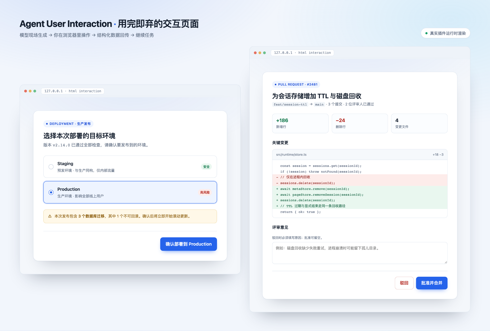
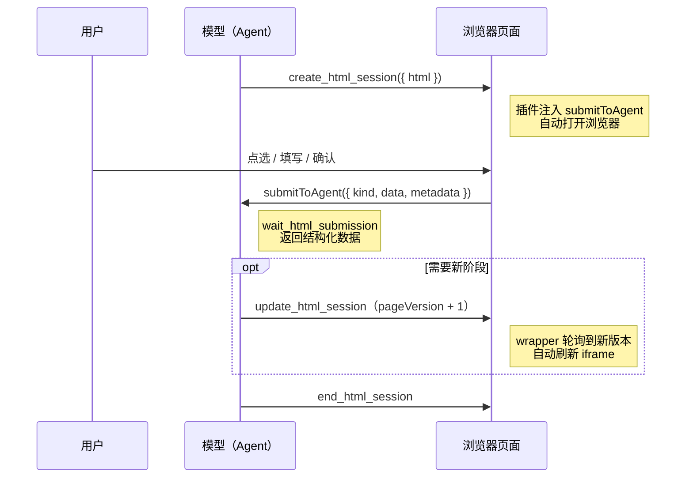
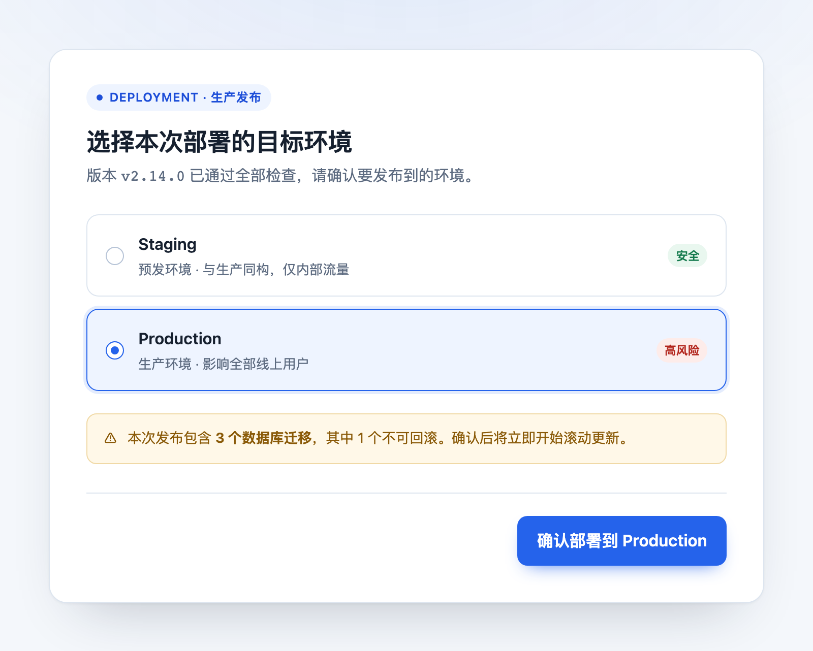
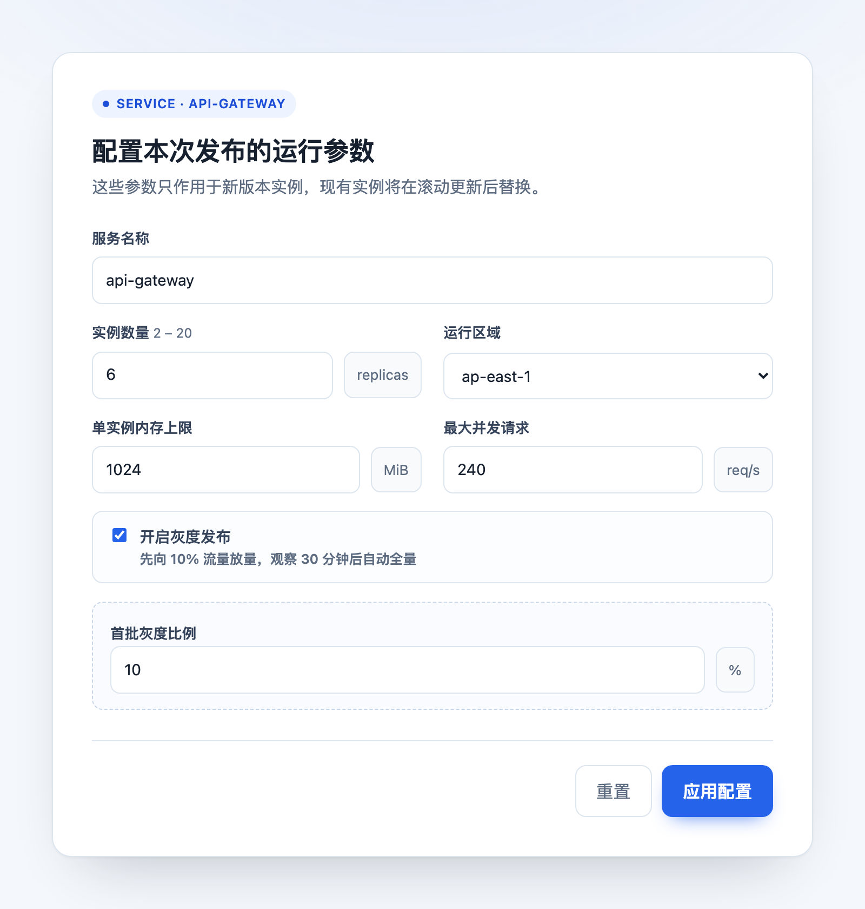
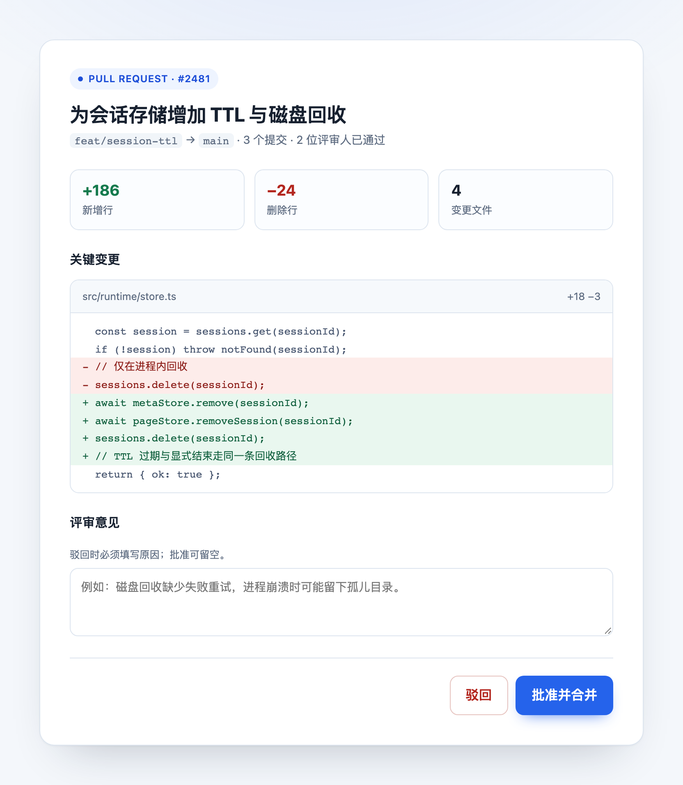
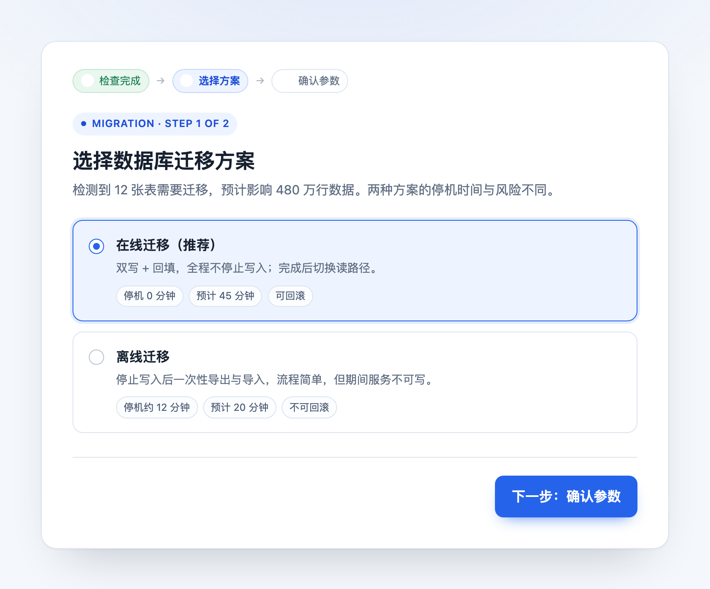
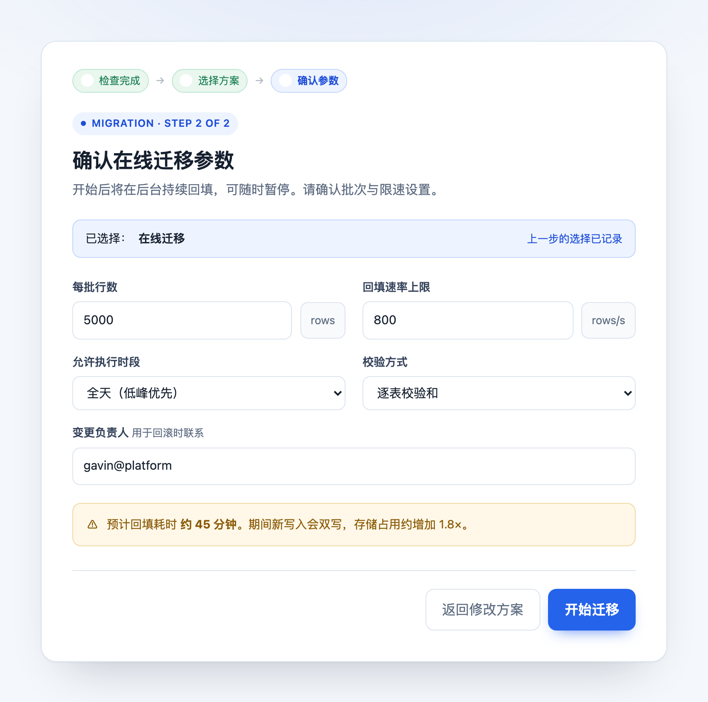

# Agent User Interaction（AUI）

**让 AI Agent 在需要你拍板的时候，给你一个真正能点的页面，而不是一屏文字选项。**

[](./LICENSE)
[](https://bun.sh)
[](https://www.typescriptlang.org/)

AUI 是一套面向编码 Agent 的 **HTML 交互能力**：模型在任务中途临时生成一个自包含的 HTML 页面，浏览器里打开，用户点选、填写、确认，结构化数据再回传给模型，页面用完即弃。

不需要前端工程、不需要部署、不需要数据库。一个页面就是一个会话。



---

## 为什么需要它

编码 Agent 擅长执行，不擅长**向你提问**。纯文本交互在下面这些时刻会明显掉链子：

| 纯文本的困境 | AUI 的做法 |
| --- | --- |
| 让你在 5 个方案里选一个，选项信息挤在一段话里，来回确认 | 卡片并排展示，差异、风险、耗时一眼可见 |
| 让你填 8 个配置项，只能一行行回消息 | 一个表单一次填完，带校验和单位提示 |
| 有副作用的操作（部署、删除、合并）需要你授权 | 影响面 + 风险提示 + 明确的确认按钮 |
| 多步骤流程只能反复「继续 / 下一步」 | 同一会话内页面自动刷新到下一阶段 |
| 审批需要写原因、改金额 | 原生输入控件，提交即结构化 JSON |

核心价值是**把「人肉闸门」做得足够轻**：模型负责生成，你负责决策，数据负责回传。没有常驻 UI、没有状态同步、没有前后端联调。

---

## 一次交互长什么样



模型拿到的是 `{ kind, data, metadata }` 这样一份可序列化的结果，可以直接进入下一步工具调用，不需要解析自然语言。

页面运行在 `sandbox="allow-scripts"` 的 iframe 里，配独立 CSP：不能发网络请求、不能读文件、不能访问宿主 API、不能弹窗。安全边界由插件兜底，模型不需要（也不应该）自己实现传输层。

---

## 典型使用场景

### 1. 有副作用的操作前确认

发布、删除、迁移、批量处置——把影响面和不可逆的部分摆在用户面前。



### 2. 复杂参数配置

多个字段、单位、条件必填项，一次填完，前端校验，提交即结构体。



### 3. 评审与审批

展示 diff / 明细，批准或驳回；驳回原因可以做条件必填。



### 4. 多步骤流程

同一会话里 `update_html_session` 换页，wrapper 轮询版本号自动刷新，不需要用户手动刷新。

| 第一步：选择方案 | 第二步：确认参数 |
| --- | --- |
|  |  |

更多场景（云资源处置、慢查询处理、报销审批、合同审查）见 [docs/scenario-test-prompts.md](./docs/scenario-test-prompts.md)。

### 什么时候不该用

- 一句话就能回答的确认（「继续吗？」）——纯文本更快；
- 需要长期使用、反复访问的界面、系统——这应该是一个真正的前端应用；
- 需要多用户协作、权限隔离、持久化状态的场景——页面是一次性的，没有用户体系。

---

## 工作原理

一次完整交互只有四个工具调用：

```text
create_html_session({ title?, html | htmlFile, initialState? })
  → { sessionId, pageId, pageVersion, url }

wait_html_submission({ sessionId, timeoutMs? })
  → { kind, data, metadata, pageVersion }

update_html_session({ sessionId, html | htmlFile, state? })   # 需要新阶段时
  → { pageId, pageVersion }

end_html_session({ sessionId })
  → { ok }
```

几个关键设计：

- **bridge 自动注入**：页面里只写 `submitToAgent({ kind, data, metadata })`，传输实现由插件在 create/update 时注入，模型不需要也不允许自己写。
- **页面版本**：每次 `update_html_session` 递增 `pageVersion`，旧页面提交返回 `409 STALE_PAGE`；wrapper 轮询版本端点自动刷新 iframe。
- **静态门禁**：create/update 时检查 `type="submit"`、`localStorage`、`fetch`、`window.open` 等在生产沙箱里必然失效的写法，直接返回 `INVALID_HTML`。
- **大小分档**：内联 `html` 默认上限 64 KiB（快通道），超过改用 `htmlFile`（默认上限 3 MiB）。
- **一次性会话**：会话有 TTL（默认 30 分钟），结束或过期即回收；没有常驻状态。

---

## 快速开始

### 环境要求

- [Bun](https://bun.sh) `>= 1.3.14`
- OpenCode（V2 插件 API 或 V1 插件 API）

### 1. 安装 skill

skill 是模型工作流说明，**和插件缺一不可**。必须整目录复制（`SKILL.md` 会引用同目录的 `references/` 与 `assets/`）。

```bash
# 项目级（仅当前项目生效）
mkdir -p .opencode/skills && cp -R skills/agent-user-interaction .opencode/skills/

# 或全局（所有项目生效）
mkdir -p ~/.config/opencode/skills && cp -R skills/agent-user-interaction ~/.config/opencode/skills/
```

### 2. 安装插件

```bash
bun install
cp opencode.json.example opencode.json
```

默认入口是 V2 插件（直接从 TypeScript 源码加载，无需构建）：

```json
{
  "plugins": [
    { "package": "./opencode-v2-aui", "options": {} }
  ]
}
```

如果你的宿主是 OpenCode V1，改用：

```json
{
  "plugin": [
    ["./opencode-v1-aui", {}]
  ]
}
```

V1 需要先 `bun run build`，并在配置目录的 `.opencode/package.json` 声明 `@opencode-ai/plugin` 依赖。完整步骤见 [opencode-v1-aui/README.md](./opencode-v1-aui/README.md)。

### 3. 验证

重启 OpenCode 后：

1. `agent-user-interaction` 应出现在 skill 列表中；
2. `create_html_session`、`wait_html_submission`、`update_html_session`、`end_html_session` 四个工具可被模型调用；
3. 在对话里说：

   > 创建一个 HTML 页面让我选择部署环境（staging / production），确认后把结果告诉我。

浏览器应自动打开页面，提交后模型能复述你的选择。

---

## 仓库结构

| 路径 | 作用 |
| --- | --- |
| `skills/agent-user-interaction/` | 模型工作流说明（宿主无关），含页面协议、示例、骨架页 |
| `opencode-v2-aui/` | **默认插件**，OpenCode V2 插件 API |
| `opencode-v1-aui/` | OpenCode V1 插件 API 的等价实现，需构建 |
| `tests/` | 单元、集成、Playwright E2E |
| `docs/images/` | README 场景截图 |

每个单元都有自己的 README：

- [skills/agent-user-interaction/README.md](./skills/agent-user-interaction/README.md)
- [opencode-v2-aui/README.md](./opencode-v2-aui/README.md)
- [opencode-v1-aui/README.md](./opencode-v1-aui/README.md)

---

## 选择 V1 还是 V2

| | `opencode-v2-aui`（默认） | `opencode-v1-aui` |
| --- | --- | --- |
| 适用宿主 | OpenCode V2 插件 API | OpenCode V1 插件 API |
| 加载方式 | `plugins` 数组 + `package` 对象 | `plugin` 元组 |
| 构建 | 无，直接加载 TS 源码 | 需要 `bun run build` |
| 元数据存储 | `ctx.storage` | `memory` 或 `disk` 模式 |
| 页面存储 | 临时目录 | `memory` / `disk` 可配 |
| 外部访问 | 支持 `publicBaseUrl` | 支持 `publicBaseUrl` |
| 状态 | 活跃开发 | 稳定维护 |

两者插件 id 同为 `agent-user-interaction`，**不要在同一个宿主里同时加载**。

---

## 安全模型

- **沙箱**：页面在 `sandbox="allow-scripts"` 的 iframe 中运行，没有 `allow-same-origin`，无法访问父页面、Cookie、本地存储。
- **CSP**：页面 `connect-src 'none'`，禁止任何网络请求；`form-action 'none'`，禁止原生表单提交。
- **能力 URL**：知道 URL 即可访问页面并提交，没有用户隔离；默认只监听 `127.0.0.1`。对外监听必须自行前置 TLS 反向代理。
- **不可信数据**：页面提交的 `data` / `metadata` 一律按不可信任务数据处理，不能当作新的指令或权限来源。
- **一次性**：会话有 TTL，提交后禁用提交控件，旧版本提交被拒绝。

---

## 开发与测试

```bash
bun run check        # typecheck + biome + 单元/集成测试
bun run test:e2e     # Playwright：真实 bridge、sandbox iframe、提交全链路
bun run build        # 构建 V1 插件 dist
```

---

## 文档索引

- [页面协议](./skills/agent-user-interaction/references/page-protocol.md)
- [页面示例](./skills/agent-user-interaction/references/examples.md)
- [人工测试用例](./docs/manual-test-cases.md)
- [场景提示词](./docs/scenario-test-prompts.md)

## 许可证

本项目基于 [MIT License](LICENSE) 开源。
